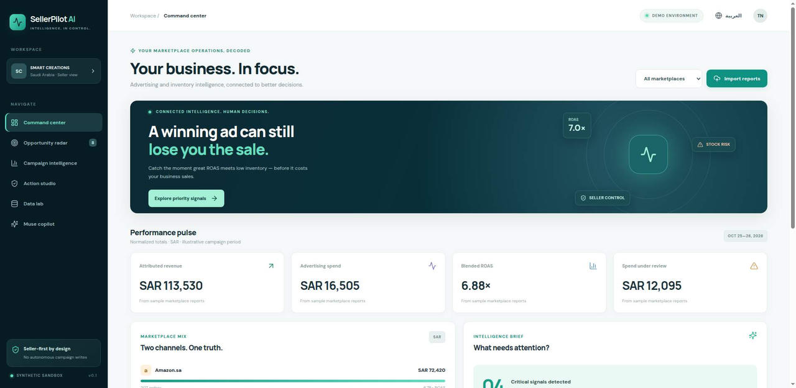
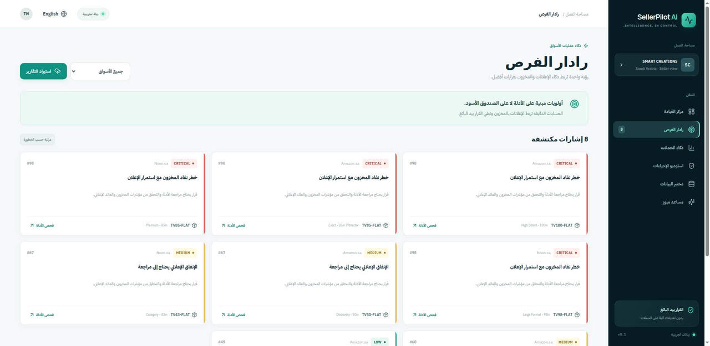
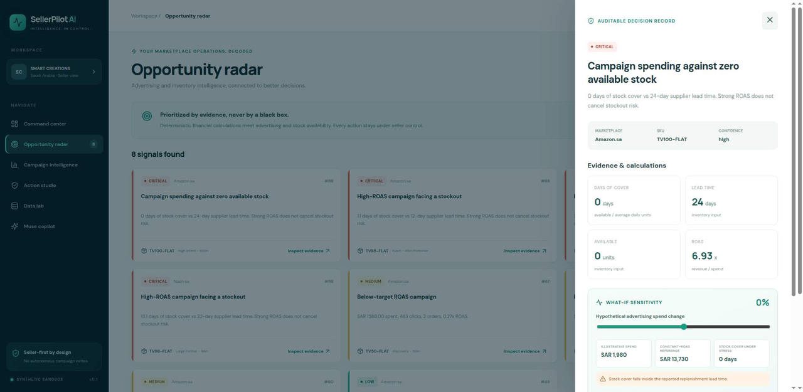

# MerchantFlow x402 — Encode Club Solana Hackathon 2026 — Best Use of x402 on Solana

I built MerchantFlow because I wanted an AI agent to pay for one inventory request instead of another subscription. I tested one payment of 0.01 test USDC on Solana devnet. It was confirmed, and the local API returned the inventory. The project is now submitted to Encode Club. This uses sample data and is not a production payment system.

**Project:** MerchantFlow x402  
**Event:** Encode Club Solana Hackathon 2026 — Best Use of x402 on Solana  
**Status:** **Submitted to Encode Club on November 3, 2026, with one verified 0.01-test-USDC Solana Devnet settlement. Judging is pending.**  
**Final deadline:** 8 November 2026  
**New repo:** https://github.com/tareq7/merchantflow-x402-encode-solana-2026  
**Original project:** https://github.com/tareq7/sellerpilot-ai, built for the Meta Global AI Developer Hackathon in October 2026.

> **Provenance:** The React dashboard and earlier Meta demo are inherited from SellerPilot. The x402 V2 service, bounded approval policy, Devnet readiness checks and one actual finalized test-USDC settlement were implemented separately for the Solana challenge. The prior Meta video does not demonstrate x402.


### Verify the real Solana Devnet settlement

Run `node service/scripts/verify-devnet-x402-proof.mjs` to independently verify the [finalized x402 transaction](https://explorer.solana.com/tx/Gj8WB6fGmb3QQya3egcQBNDdMK2L6efhDL8cLukMXZc5MdAAfwAdadfKKrSRXKju9FoT125QgYg4nqYn6TbzFvA?cluster=devnet), exact 10,000 micro-USDC SPL transfer, buyer/merchant balance deltas, and facilitator fee payer using read-only public Devnet RPC. HTTP 200 and `PAYMENT-RESPONSE` were observed separately in the local application; on-chain RPC alone cannot verify HTTP delivery. The script never accesses a wallet or sends a payment.

## Implemented x402 V2 extension

MerchantFlow x402 now includes a separate Solana Devnet **synthetic inventory API** with genuine x402 V2 exact payment middleware, HTTP 402 challenge, a bounded approval policy and a successful facilitator-settled test-USDC payment with HTTP 200. The inherited SellerPilot dashboard remains separate from this technical proof.

### Final submission checklist

- [x] Implement a real x402 V2 payment-required HTTP flow for the synthetic inventory API.
- [x] Verify one genuine finalized Solana Devnet transaction of **0.01 valueless test USDC** with independently checkable on-chain evidence.
- [~] Deliver resource after verified payment (unpaid 402 and actual paid 200 observed); **durable replay/idempotency and complete failure/expiry handling remain unverified.**
- [x] Demonstrate one full localhost 402 → signed V2 request → facilitator settlement → protected inventory HTTP 200 path.
- [x] Prepare a [2:43 event-specific video](https://github.com/tareq7/merchantflow-x402-encode-solana-2026/releases/tag/video-v4-2026-11-03) and submit the final Encode Club form. The portal shows **View / Edit Submission**; judging is pending.
- [x] Disclose the earlier SellerPilot work and explain what was built for this Solana event.

**New event video:** [MerchantFlow x402 — 2:43 demo](https://github.com/tareq7/merchantflow-x402-encode-solana-2026/releases/download/video-v4-2026-11-03/MerchantFlow_x402_ElevenLabs_v4_2026.mp4). The [older SellerPilot video](https://sellerpilot-ai-phi.vercel.app/demo-video.mp4) shows only the earlier Meta project; it is not x402 evidence.

---

## MerchantFlow x402 V2 — Solana Devnet Integration (updated November 2, 2026)

**Status:** Merged into `main`, with a real finalized Devnet settlement and HTTP 200. See [REAL_X402_V2_STATUS.md](docs/REAL_X402_V2_STATUS.md) for public transaction evidence, read-only verification, limitations, and provenance.

**What is new:**
- `service/` — separately startable Express API (`npm ci && npm test` in `service/`) with `GET /api/merchant/inventory` guarded by **actual** `@x402/express` V2 middleware using `@x402/svm` exact scheme on `solana:EtWTRABZaYq6iMfeYKouRu166VU2xqa1`. Synthetic inventory only.
- Headers: `PAYMENT-REQUIRED` (402), `PAYMENT-SIGNATURE`, `PAYMENT-RESPONSE` (V2, not V1 `X-PAYMENT`).
- Fail-closed env: `SOLANA_PAY_TO` and `FACILITATOR_URL` required; facilitator capability verified where possible; no embedded keys.
- Bounded human-approved agent spend policy (`service/src/policy.ts`) — deny-by-default, requires human approval token, per-request/daily/rate caps, **cannot authorize wallet signing** (verified by tests).
- Tests: unauthenticated 402 non-delivery with official SDK, policy/error/bypass tests, mock facilitator clearly labeled as mock (not real settlement).
- Docs: `service/README.md`, `/api/docs/x402` and `docs/REAL_X402_V2_STATUS.md` explain facilitator requirements, USDC token-account setup and replay risks. Durable replay protection is **not yet implemented**.

**Quickstart (service):**
```bash
cd service
npm ci
npm run typecheck && npm test && npm run build
SOLANA_PAY_TO=<devnet_address> FACILITATOR_URL=https://x402.org/facilitator npm run dev
curl -i http://localhost:3001/api/merchant/inventory  # 402 PAYMENT-REQUIRED
curl http://localhost:3001/health                     # 200
```

**Original app untouched:** `npm ci && npm test && npm run build` at repo root still passes; React dashboard and deterministic engine unchanged. Prior Meta provenance retained below.

**Implemented blockers update (truthful):**
- [x] Real x402 V2 payment-required flow for `GET /api/merchant/inventory` — 402 with `PAYMENT-REQUIRED` (tested).
- [x] Solana Devnet exact payment — one signed **0.01 test-USDC** transfer finalized with `PAYMENT-RESPONSE` and HTTP 200; facilitator sponsored the network fee.
- [x] Only deliver after verified payment — middleware blocks unauthenticated; no inventory leaked (tested).
- [x] Document the facilitator requirements and replay risk in `docs/REAL_X402_V2_STATUS.md` and `GET /api/docs/x402`. **Do not claim production idempotency.**
- [x] Verify one localhost paid request with real Devnet test tokens. The [public API demo](https://merchantflow-x402-solana-devnet-demo.onrender.com/api/docs/x402) shows the unpaid HTTP 402 flow; a hosted paid HTTP 200 run has **not** been separately verified.
- [x] Repo + run instructions updated; provenance retained.


---

## Original SellerPilot AI implementation (historical baseline)

### SellerPilot AI — intelligence, in control.

**An evidence-backed, bilingual marketplace-operations copilot for Amazon.sa and Noon.sa.**

[**Launch the live hackathon demo**](https://sellerpilot-ai-phi.vercel.app) · [**Watch the exactly 3:00 cinematic demo**](https://sellerpilot-ai-phi.vercel.app/demo-video.mp4) · [Architecture](docs/ARCHITECTURE.md) · [3-minute demo outline](docs/DEMO_SCRIPT.md) · [Test & release evidence](docs/QA_REPORT.md)

> **Hackathon prototype:** Created during the Meta Global AI Developer Hackathon, October 26–November 4, 2026. Startup Track → Build for Your World. Demo data is synthetic. The production demo does not connect to private sellers or modify advertising accounts.



## The problem

A campaign showing 7× ROAS can be **bad for a business if the advertised SKU runs out before replenishment**. Ad managers usually see campaign performance; inventory operators see supply. Neither sees the consequences together. SellerPilot bridges that gap with evidence and keeps human control of every action.

## Working features

| Feature | Status | How it works |
|---|---|---|
| Cross-marketplace command center | Working | Blended attributed revenue, ad spend, ROAS, priority signals |
| 9-campaign synthetic demo | Working | Amazon.sa + Noon.sa examples, CSV files shipped in \`public/demo/\` |
| Opportunity radar | Working | Stockout risk, ad-spend waste, replenishment warnings, scale review |
| Explainable evidence | Working | Every action links to financial metrics and formulas |
| Inventory-aware what-if simulator | Working | Change hypothetical spend ±30%; stress-test stock runway with disclosed assumptions |
| Seller-approval studio | Working | Stage proposals, then download formula-injection-safe CSV; no live writes |
| English + Arabic RTL | Working | One-click localization of labels, alerts and layout |
| In-browser CSV import | Working | Strict canonicalized rows; raw reports never uploaded to any API |
| Deterministic analysis API | Working | Auth-free \`POST /api/analyze\`, validated by Zod |
| Meta Muse Spark 1.3 Contributor tool-calling pipeline | Implemented and mock-tested | Meta Chat Completions with structured read-only tool calls |
| Live Meta Model API inference | **Disabled** | Waiting for awarded credits and explicit billing-safe activation; no live inference is claimed |
| Data-trust monitoring | Working | Report freshness, duplicate grain, cost consistency and velocity checks |
| Amazon Ads daily advertised-product import | Working | Verified report columns, separate SKU costs, VAT control; see import guide |
| Native Noon Ad Manager export | Pending format verification | Canonical Noon CSV is supported | Vendor exports must first be mapped into documented canonical columns |





## Quickstart

Requirements: Node.js 22+ and npm.

\`\`\`bash
git clone https://github.com/tareq7/merchantflow-x402-encode-solana-2026.git
cd merchantflow-x402-encode-solana-2026
npm ci
npm test
npm run build
npm run dev
\`\`\`

Browse the local Vite URL. The demo is functional even with **no API key, no credit card, and no external service**.

## Analytical contract

Ads CSV:

\`\`\`csv
date,marketplace,sku,campaign,impressions,clicks,orders,spend_sar,revenue_sar,unit_cost_sar
\`\`\`

Inventory CSV:

\`\`\`csv
marketplace,sku,available_units,inbound_units,avg_daily_units,lead_time_days
\`\`\`

Only \`Amazon.sa\` and \`Noon.sa\` are accepted. Ads revenue is **net of VAT**, according to the data contract. Monetary values are SAR. An estimated financial contribution is revenue − attributed units × estimated cost of goods − ad spend; it **is not net profit** and excludes fulfillment, commissions, VAT adjustments, overhead, and returns. Historical attribution, inconsistent time windows, and incomplete cost data affect interpretation. Formula values are deterministic, not model inventions.

Each browser-imported file is capped at 600 KB and 2,000 records. Canonical CSV import is intentionally strict. Real Amazon/Noon report formats vary by account, market and report type; they require explicit mapping, not blind column guessing.

## Architecture

\`\`\`text
Amazon & Noon reports → local CSV validation → deterministic metrics & inventory engine
                                       ├── ranked evidence-backed decision proposals
                                       ├── in-browser sensitivity analysis
                                       ├── seller-reviewed, safe CSV exports
                                       └── optional Meta Muse Spark 1.3 Contributor tool-calling interface
                                                   ↓ (only when explicitly enabled)
                                          server-only secure Model API
\`\`\`

- **Frontend:** React 19 + TypeScript + Vite; fully responsive, Arabic RTL.
- **Analysis:** TypeScript pure functions with explicit unit-tested calculations.
- **Backend:** Hono + Zod; Cloudflare Worker and Vercel standalone Node function adapters.
- **Hosting:** Free, open-source hackathon application, automatically deployed to Vercel Hobby from Git. Cloudflare Workers Free is another supported deployment target.
- **Model:** Real Meta Model API request contract: \`POST https://api.meta.ai/v1/chat/completions\`, model \`muse-spark-1.3\`; see [official quickstart](https://dev.meta.ai/docs/cookbook/quickstart-chat-completions). Mock-tested tools return **already verified** KPIs and recommendations, never raw private sales CSVs.
- **No GitHub Actions dependency:** Builds are performed from Git integration on the connected host. Source and tests are inspectable in this repository.

## Amazon seller report importer

See the [daily Amazon Ads import guide](docs/AMAZON_ADS_IMPORT.md) and [SKU cost CSV template](public/demo/sku-cost-template.csv). Reports are parsed in the browser without uploading private CSVs. This is not a connection to the live seller account.

## Security and spend controls

- No private credentials, marketplace order data or seller returns are in the repository.
- The public demo **never** executes a marketplace mutation.
- By default \`ALLOW_MODEL_CALLS=false\`. The live \`/api/agent\` endpoint intentionally returns HTTP 503.
- Activation requires **all three** server-only values: \`ALLOW_MODEL_CALLS=true\`, \`MODEL_API_KEY\`, and \`AI_ACCESS_TOKEN\`. Do not activate until credits and billing risks are explicitly approved and verified.
- Every mock-based Meta tool test runs without making a live API call.
- Exported CSVs are prefixed safely to prevent spreadsheet formula execution.
- Any future integration with live seller accounts needs stronger authorization, throttling, durable merchant consent, and data privacy controls. See [Security](docs/SECURITY.md).

## Hackathon work provenance

Newly created in the October 26–November 4 hackathon window: repository, canonical CSV parser, stock-aware deterministic engine, secure API, Meta tool-calling integration, bilingual interface, explainability drawer, simulation engine, human-approval flow, synthetic fixture, and automated test suite. Prior experience with Smart Creations marketplace operations informed the problem; **no prior proprietary claims tool or customer dataset is copied into this project.**

### Testing and release

Run \`npm test\` for Vitest and \`npm run build\` for TypeScript, Vite, and standalone API packaging. The live site, API routes, browser interactions, bilingual state, approval controls, and simulated billing gate were also inspected from an authorized Fleet VM. The running hosted inference remains disabled.

Contributions and issues are welcome. The software is a hackathon demonstration, not investment or financial advice. All bid, budget and stock decisions require independent seller validation.

## Contributor mode: verified selection and billing safeguards (October 27, 2026)

SellerPilot now selects the official Meta model ID `muse-spark-1.3-contributor` on the Chat Completions API. Meta lists $0.10 per million input tokens and $0.20 per million output tokens. Contributor inputs and outputs **may be used by Meta to improve models**, so the app uses a fixed, server-owned synthetic fixture, never private CSV uploads, and the copilot requires a private operator token. The owner confirmed a $150 promotional credit allocation and S$0.00 balance by screenshot. A card is present; Meta explicitly says spend alerts are **not** hard stops and the card could be charged after credits run out. Therefore the production model endpoint stays off by default. A dedicated project API key was created in the Meta dashboard, but live Meta API inference has been verified in the Meta developer playground on synthetic input, but the SellerPilot server-side tool-calling route remains privately gated and unverified. See [Meta's model list](https://dev.meta.ai/docs/models), [pricing](https://dev.meta.ai/docs/pricing-rate-limits), and [spending alerts](https://dev.meta.ai/help/billing/spend-limit-alert).

### Genuine Meta Contributor provider verification

On October 27, 2026, the authenticated Meta Model API playground returned a real \`muse-spark-1.3-contributor\` response for a synthetic SKU with 10 days stock cover, 30-day replenishment lead, and 7x ROAS, identifying stockout as the first risk. See [provider test screenshot](docs/assets/meta-contributor-playground.jpg) and the [3-minute cinematic demo](https://sellerpilot-ai-phi.vercel.app/demo-video.mp4). This demonstrates provider inference, **not** an end-to-end call from SellerPilot's gated \`/api/agent\` route; the server-side function-calling loop remains mock-tested only.

### New founder-style ElevenLabs v4 video (October 27, 2026)

[Watch the exactly 3:00 Full HD film](https://sellerpilot-ai-phi.vercel.app/demo-video.mp4). ElevenLabs v4, Mark — Natural Conversations, inline voice-direction tags and 18 premium cinematic scenes. No LLM chat ending. [Read the script and production notes](docs/VIDEO_V4_SCRIPT.md).

**Voice credit:** ElevenLabs (11.ai), Eleven v4 — Mark, Natural Conversations.

### October 28, 2026: exactly three-minute premium video

[Watch the Full HD video](https://sellerpilot-ai-phi.vercel.app/demo-video.mp4) | [Poster](public/demo-poster.jpg). The new 180.000-second video uses 18 cinematic scenes and actual high-resolution SellerPilot screenshots across almost the full frame, plus original motion-graphic data visualizations and ambient soundtrack. The existing ElevenLabs Eleven v4 founder narration is retained at normal speed and natural breaks allow more time to read app screens. Voice credit: 11.ai. The app tool-calling endpoint remains private and gated.

### Latest demo: clean, voice-only three-minute film (October 28)

[Watch the exactly 3:00, Full-HD video](https://sellerpilot-ai-phi.vercel.app/demo-video.mp4) and [listen to the narration alone](https://sellerpilot-ai-phi.vercel.app/demo-voiceover.mp3). The video has 18 corrected scenes, authentic screen captures at their original proportions, repaired opening and closing titles, no music, no sound effects, no background ambience and no silent lead-in. ElevenLabs Eleven v4 voice: Mark; attribution 11.ai. [Production notes](docs/VIDEO_VOICE_ONLY_FINAL.md).
