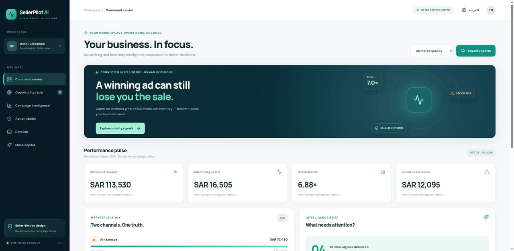
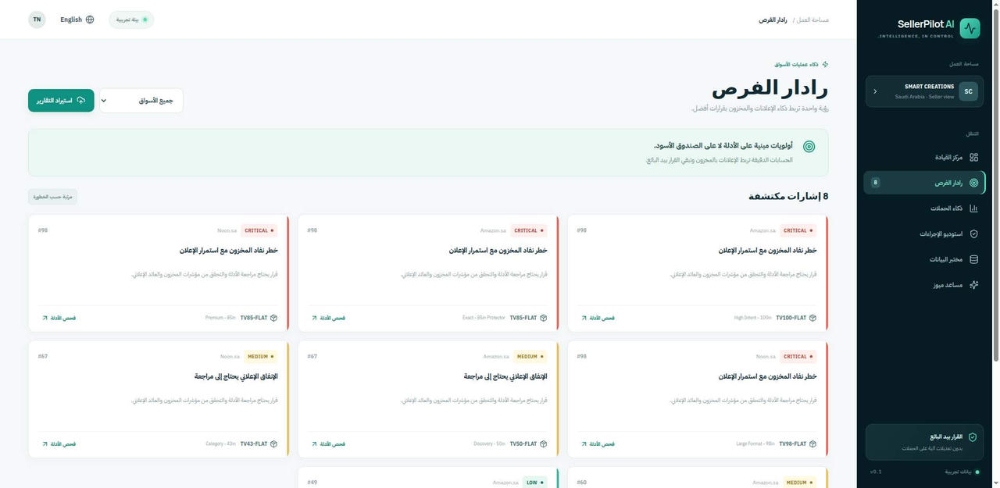
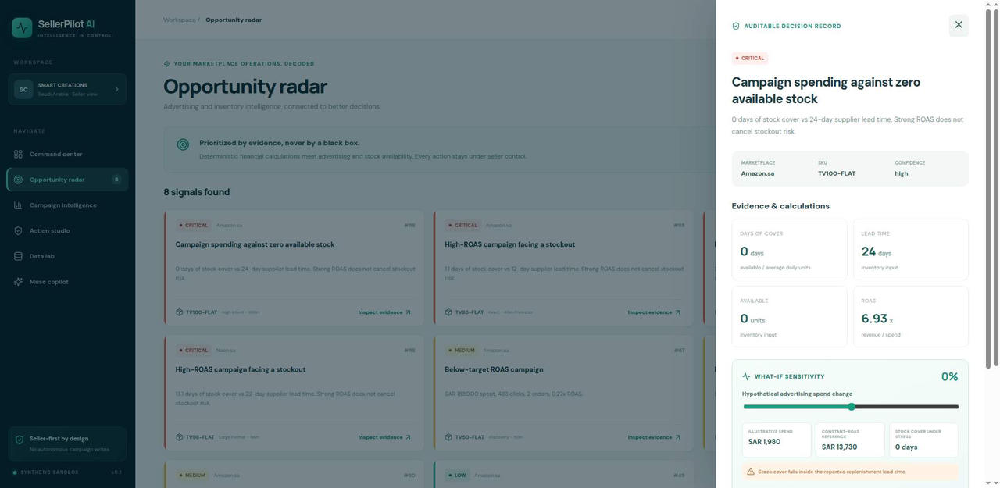

# SellerPilot AI — intelligence, in control.

**An evidence-backed, bilingual marketplace-operations copilot for Amazon.sa and Noon.sa.**

[**Launch the live hackathon demo**](https://sellerpilot-ai-phi.vercel.app) · [Architecture](docs/ARCHITECTURE.md) · [3-minute demo outline](docs/DEMO_SCRIPT.md) · [Test & release evidence](docs/QA_REPORT.md)

> **Hackathon prototype:** Created during the Meta Global AI Developer Hackathon, October 26–November 4, 2026. Startup Track → Build for Your World. Demo data is synthetic. The production demo does not connect to private sellers or modify advertising accounts.

## The problem

A campaign showing 7× ROAS can be **bad for a business if the advertised SKU runs out before replenishment**. Ad managers usually see campaign performance; inventory operators see supply. Neither sees the consequences together. SellerPilot bridges that gap with evidence and keeps human control of every action.

## Working features

| Feature | Status | How it works |
|---|---|---|
| Cross-marketplace command center | Working | Blended attributed revenue, ad spend, ROAS, priority signals |
| 9-campaign synthetic demo | Working | Amazon.sa + Noon.sa examples, CSV files shipped in \`public/demo/\` |
| Opportunity radar | Working | Stockout risk, ad-spend waste, replenishment warnings, scale review |
| Explainable evidence | Working | Every action links to financial metrics and formulas |
| Inventory-aware what-if simulator | Working | Change hypothetical spend ±30%; stress-test stock runway with disclosed assumptions |
| Seller-approval studio | Working | Stage proposals, then download formula-injection-safe CSV; no live writes |
| English + Arabic RTL | Working | One-click localization of labels, alerts and layout |
| In-browser CSV import | Working | Strict canonicalized rows; raw reports never uploaded to any API |
| Deterministic analysis API | Working | Auth-free \`POST /api/analyze\`, validated by Zod |
| Meta Muse Spark 1.3 tool-calling pipeline | Implemented and mock-tested | Meta Chat Completions with structured read-only tool calls |
| Live Meta Model API inference | **Disabled** | Waiting for awarded credits and explicit billing-safe activation; no live inference is claimed |
| Data-trust monitoring | Working | Report freshness, duplicate grain, cost consistency and velocity checks |
| Amazon Ads daily advertised-product import | Working | Verified report columns, separate SKU costs, VAT control; see import guide |
| Native Noon Ad Manager export | Pending format verification | Canonical Noon CSV is supported | Vendor exports must first be mapped into documented canonical columns |

## Quickstart

Requirements: Node.js 22+ and npm.

\`\`\`bash
git clone https://github.com/tareq7/sellerpilot-ai.git
cd sellerpilot-ai
npm ci
npm test
npm run build
npm run dev
\`\`\`

Browse the local Vite URL. The demo is functional even with **no API key, no credit card, and no external service**.

## Analytical contract

Ads CSV:

\`\`\`csv
date,marketplace,sku,campaign,impressions,clicks,orders,spend_sar,revenue_sar,unit_cost_sar
\`\`\`

Inventory CSV:

\`\`\`csv
marketplace,sku,available_units,inbound_units,avg_daily_units,lead_time_days
\`\`\`

Only \`Amazon.sa\` and \`Noon.sa\` are accepted. Ads revenue is **net of VAT**, according to the data contract. Monetary values are SAR. An estimated financial contribution is revenue − attributed units × estimated cost of goods − ad spend; it **is not net profit** and excludes fulfillment, commissions, VAT adjustments, overhead, and returns. Historical attribution, inconsistent time windows, and incomplete cost data affect interpretation. Formula values are deterministic, not model inventions.

Each browser-imported file is capped at 600 KB and 2,000 records. Canonical CSV import is intentionally strict. Real Amazon/Noon report formats vary by account, market and report type; they require explicit mapping, not blind column guessing.

## Architecture

\`\`\`text
Amazon & Noon reports → local CSV validation → deterministic metrics & inventory engine
                                       ├── ranked evidence-backed decision proposals
                                       ├── in-browser sensitivity analysis
                                       ├── seller-reviewed, safe CSV exports
                                       └── optional Meta Muse Spark 1.3 tool-calling interface
                                                   ↓ (only when explicitly enabled)
                                          server-only secure Model API
\`\`\`

- **Frontend:** React 19 + TypeScript + Vite; fully responsive, Arabic RTL.
- **Analysis:** TypeScript pure functions with explicit unit-tested calculations.
- **Backend:** Hono + Zod; Cloudflare Worker and Vercel standalone Node function adapters.
- **Hosting:** Automatic Git-push deploys to a Vercel Hobby **noncommercial personal hackathon demonstration**. See the [Vercel Hobby policy](https://vercel.com/docs/plans/hobby); commercialization requires a commercially permitted hosting plan/platform. Cloudflare Workers Free remains a possible alternative when its authorization is restored.
- **Model:** Real Meta Model API request contract: \`POST https://api.meta.ai/v1/chat/completions\`, model \`muse-spark-1.3\`; see [official quickstart](https://dev.meta.ai/docs/cookbook/quickstart-chat-completions). Mock-tested tools return **already verified** KPIs and recommendations, never raw private sales CSVs.
- **No GitHub Actions dependency:** Builds are performed from Git integration on the connected host. Source and tests are inspectable in this repository.

## Amazon seller report importer

See the [daily Amazon Ads import guide](docs/AMAZON_ADS_IMPORT.md) and [SKU cost CSV template](public/demo/sku-cost-template.csv). Reports are parsed in the browser without uploading private CSVs. This is not a connection to the live seller account.

## Security and spend controls

- No private credentials, marketplace order data or seller returns are in the repository.
- The public demo **never** executes a marketplace mutation.
- By default \`ALLOW_MODEL_CALLS=false\`. The live \`/api/agent\` endpoint intentionally returns HTTP 503.
- Activation requires **all three** server-only values: \`ALLOW_MODEL_CALLS=true\`, \`MODEL_API_KEY\`, and \`AI_ACCESS_TOKEN\`. Do not activate until credits and billing risks are explicitly approved and verified.
- Every mock-based Meta tool test runs without making a live API call.
- Exported CSVs are prefixed safely to prevent spreadsheet formula execution.
- A production commercial version needs stronger authorization, throttling, durable merchant consent, and data privacy controls. See [Security](docs/SECURITY.md).

## Hackathon work provenance

Newly created in the October 26–November 4 hackathon window: repository, canonical CSV parser, stock-aware deterministic engine, secure API, Meta tool-calling integration, bilingual interface, explainability drawer, simulation engine, human-approval flow, synthetic fixture, and automated test suite. Prior experience with Smart Creations marketplace operations informed the problem; **no prior proprietary claims tool or customer dataset is copied into this project.**

### Testing and release

Run \`npm test\` for Vitest and \`npm run build\` for TypeScript, Vite, and standalone API packaging. The live site, API routes, browser interactions, bilingual state, approval controls, and simulated billing gate were also inspected from an authorized Fleet VM. The running hosted inference remains disabled.

Contributions and issues are welcome. The software is a hackathon demonstration, not investment or financial advice. All bid, budget and stock decisions require independent seller validation.
